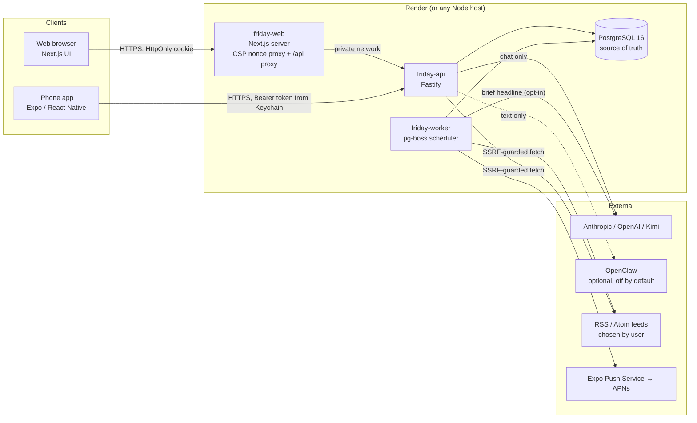

# Architecture

## Responsibilities

| Component | Owns | Does not |
|---|---|---|
| `apps/api` | Auth, sessions, authorization, validation, CRUD, chat persistence/streaming, AI gateway, budgets, health | Run schedules (no `setInterval`) |
| `apps/worker` | Cron via pg-boss: reminder dispatch (every minute), push sending, briefs & learning nudges (every 5 min), news scans (every 15 min, per-user slots), retention cleanup (daily) | Serve HTTP |
| `apps/web` | UI, CSP nonces, a same-origin `/api/*` proxy so cookies stay first-party | Hold secrets or call providers |
| `apps/mobile` | UI, Keychain token storage, local notifications, push registration, on-device speech recognition | Hold provider keys |
| `packages/shared` | Zod schemas, API types, NL parser, recurrence/DST maths, SRS, news dedupe, redaction | Side effects |

## Request flow (chat example)

1. Client sends `POST /chat/send` with a client-generated `clientMessageId` (idempotency).
2. API authenticates, validates with Zod, rate-limits, and stores the user message.
3. Deterministic code checks for task/reminder intent and builds **proposals** (`packages/shared/src/nlparse.ts`). Nothing is created.
4. The AI gateway picks a provider (user order → fallback), enforces budgets, streams text back as NDJSON, and records token usage.
5. The final assistant message (complete / error / cancelled) is persisted. The client renders proposal cards; only the user's **Confirm** calls `POST /tasks` or `POST /reminders`.

## Scheduling and reliability

- Times are stored in UTC (`timestamptz`); each user has an IANA timezone. Recurrences are computed in local wall-clock time with Luxon, so a 09:00 daily reminder stays at 09:00 across DST changes (tested).
- **Reminders:** the worker claims due rows with `SELECT … FOR UPDATE SKIP LOCKED`, inserts deliveries guarded by a unique `(user, kind, occurrence_key, channel)` index, and advances the schedule in the same transaction — safe with multiple workers or restarts (tested with three concurrent dispatchers).
- **Job idempotency:** every job run is recorded in `job_runs` with a unique `(job, key)`; per-user slots use keys like `user:date:morning`. Failed runs can be retried; runs stuck `running` for 15 minutes are reclaimable.
- **Missed-run policy:** scheduled slots run only within 3 hours of their time; overdue reminders are delivered once with a “missed while offline” note and then roll forward.
- **Retries:** pg-boss retries failed jobs twice with backoff; push deliveries retry up to 3 times then show `failed` with a reason.
- **Retention:** conversations 180 days after last activity, deliveries 90 days, unsaved news 30 days, job runs 30 days, audit events 365 days.

## Data model

21 tables, all user-owned rows carry `user_id` with `ON DELETE CASCADE`: `users`, `sessions`, `user_preferences`, `projects`, `tasks`, `task_events`, `reminders`, `notification_deliveries`, `devices`, `conversations`, `messages`, `lessons` (shared curriculum), `lesson_progress`, `quiz_attempts`, `news_sources`, `news_items`, `notes`, `briefs`, `ai_usage`, `job_runs`, `audit_events`. Schema: `apps/api/src/db/schema.ts`; migrations: `apps/api/drizzle/`.

Provider API keys are **not** stored in the database — only in the server environment.
